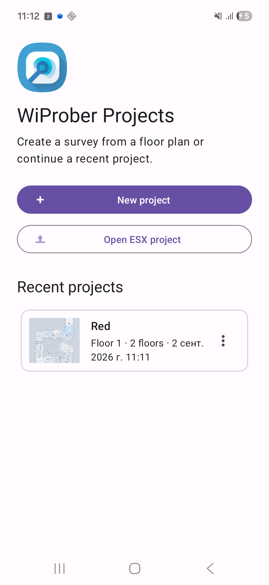
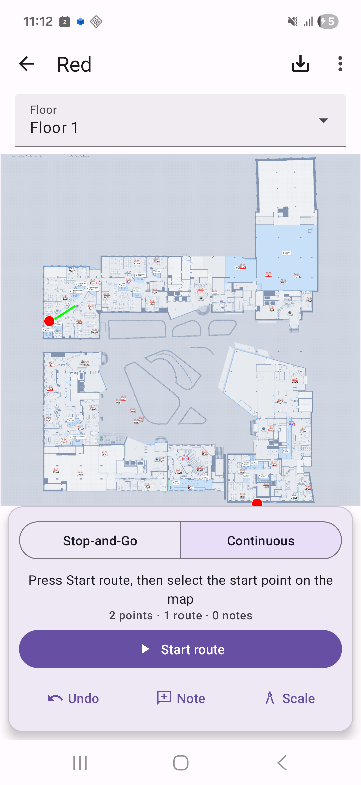

# WiProber

**WiProber** is an open-source Android application for conducting Wi-Fi site surveys. It allows users to load a floor plan, perform Wi-Fi scans using different modes (Stop-and-Go or Continuous), and export the collected data into the `.esx` format, compatible with Ekahau Pro™.

This project was born out of the need for a simple, mobile-first tool for network engineers and enthusiasts to perform quick on-site surveys without expensive, proprietary hardware.

Version **3.0.0** requires **Android 11 (API 30) or newer**. It adds a project hub, recent projects, multi-floor surveying, and ESX import that preserves original archive contents while adding new surveys.

## Screenshots

| Project hub | Multi-floor survey |
| :---: | :---: |
| [](docs/screenshots/v3-project-hub.png) | [](docs/screenshots/v3-continuous-survey.png) |
| Create a project, import an ESX file, or resume recent work. | Switch floors and continue surveying with points, routes, notes, and scale calibration. |

Select a screenshot to view it at full resolution.

## Features

*   **Interactive Floor Plan:** Load any image as a floor plan, with support for zoom and pan.
*   **Local Project Hub:** Create a project, open an ESX file, or continue one of the most recently used local projects.
*   **Wi-Fi Scanner (experimental):** Open a standalone monitor from Project Hub with connected RSSI history, channel-width diagrams, BSSID filters, and public Android network/IE details.
*   Open **iperf3** beside the scanner to run a TCP or UDP test against your own iperf3 server. Choose upload or reverse (download), duration, parallel streams and report interval. An empty or zero interval shows the final summary only. Edit the displayed command to run other iperf3 client options. Flags appended to the generated command stay in place when you change a field.
*   **Project Status and Management:** Recent projects expose explicit loading/error states and a confirmed local-delete action. The survey screen shows active-floor counts and complete-project export results.
*   **Multi-floor Projects:** Import every supported floor from an ESX archive, switch floors while surveying, and add new named floor plans.
*   **Two Survey Modes:**
    *   **🔴 Stop-and-Go:** Tap a point, wait for a scan, move to the next point. High precision.
    *   **👣 Continuous (New in v2.0):** Tap "Start", walk along a path, and tap to mark turns. The app scans continuously in the background. Faster data collection.
*   **Advanced Data Collection:** Gathers comprehensive data for each network, including SSID, BSSID, RSSI, frequency, security standard (802.11ax/ac/n...), and raw Information Elements (IEs).
*   **Dynamic Adapter Info:** Automatically detects your device model (e.g., "Samsung S23") and injects this metadata into the project file.
*   **Note-Taking:** Add text and photo annotations directly onto the map to document access point locations, obstacles, or other points of interest.
*   **Scale Calibration:** Set the physical scale of the map for accurate-to-reality measurements.
*   **Ekahau-compatible `.esx` Export:** New projects are generated from scratch with the required JSON files, binary Wi-Fi tracks, floor plans, and attached note images. Imported projects keep the complete source archive and append WiProber surveys without regenerating the original measurements.
*   **`.esx` Import:** Imports floor plans, route geometry, scale, and map-positioned picture notes for display. Original Wi-Fi tracks, spectrum data, and unknown payloads remain opaque and are preserved for the next export.

## Limitations & System Requirements

This is a non-commercial, open-source project. Please be aware of the following system limitations:

*   **Wi-Fi Scan Throttling:**
    *   **The Issue:** Android limits third-party apps to **4 scans per 2 minutes**.
    *   **Stop-and-Go Mode:** WiProber enforces a countdown to prevent errors if you scan too fast.
    *   **Continuous Mode:** **REQUIRED:** You MUST disable "Wi-Fi scan throttling" in Developer Options. WiProber will check this setting and warn you if it's enabled.
*   **Location Services (GPS):** Android requires Location Services to be enabled to see Wi-Fi networks. The app will prompt you to turn it on.
*   **No "My Networks" Detection:** The app currently does not automatically identify or flag your own networks ("My Networks"). This must be done manually within Ekahau Pro after import.
*   **No AP Merging:** WiProber creates a new, separate access point (`accessPoints.json`) for every unique BSSID found. It does not attempt to group multiple radios (e.g., 2.4-GHz and 5-GHz radios) under a single physical access point device. This grouping should be performed manually in Ekahau.
*   **ESX Editing Scope:** WiProber does not display or edit imported RSSI/frequency/spectrum measurements, walls, requirements, or AP grouping. Schema-v3 projects preserve those source entries unchanged and add new WiProber survey data alongside them. New projects still contain the supported WiProber-generated subset. Projects imported by older schema-v2 builds must be re-imported from their original ESX to gain source-preservation guarantees.
*   **Android Version:** WiProber v3 requires Android 11 (API 30) or newer. Android 10 and older devices cannot install or update to v3. Public beacon Information Elements and `wifiStandard` are part of the v3 scan baseline, although the exact IE set still depends on the device chipset and driver.

## Getting Started

### Prerequisites
*   Android Studio (latest version recommended)
*   An Android device with Android 11 (API 30) or higher.

### Building and Running
1.  Clone the repository: `git clone https://github.com/htechno/WiProber.git`
2.  Open the project in Android Studio.
3.  Let Gradle sync and download all dependencies.
4.  Build and run the application on your device.

### Building an APK on GitHub

Open **Actions → Build APK → Run workflow**, select the branch, and start the build. Pull requests targeting `main` also run this workflow; ordinary pushes and tags do not automatically build or publish a release.

The workflow runs JVM tests and Android lint, builds the app and instrumentation-test APKs, and uploads the app as the **wiprober-debug-apk** artifact. Download that artifact from the successful run and extract **WiProber-debug.apk**. It includes the source commit, APK metadata, and a SHA-256 checksum. Artifacts are retained for 30 days; device tests and the external customer ESX fixture are not run on GitHub.

This is a debug-signed APK (`com.example.wiprober.debug`), not a production-signed release. GitHub runners may generate different debug keys between builds, so an existing debug installation may not accept an update. Export your projects before uninstalling: uninstalling removes app-owned projects and their source archives.

## How to Use

### Projects
1.  On the start screen, tap **"New project"** and select the first floor-plan image, or tap **"Open ESX project"**.
2.  A multi-floor ESX is imported as one project and initially opens on its first floor.
3.  Use the anchored **Floor** dropdown on the survey screen to switch floors. Its last item, **Add floor…**, creates another named floor.
4.  Projects are copied into app-owned storage, autosaved, and appear under **Recent projects** for later use. For an imported project, the complete original ESX is retained as an immutable source archive.
5.  Use the three-dot action on a recent project to delete its complete local workspace. This is permanent and includes the retained source ESX, so export a copy first if needed.

### Stop-and-Go Mode (Default)
1.  Open or create a project.
2.  Tap on the map to scan. A **Red Dot** will appear.
3.  Wait for the scan to finish. Repeat.

### Wi-Fi Scanner (experimental)
1. Tap **Wi-Fi scanner** at the top right of Project Hub. No project is required.
2. **Disable Wi-Fi scan throttling** in Developer Options. This mode is blocked until throttling is off; the setup dialog links to Developer Options.
3. Enable Wi-Fi and Location Services, and grant **Precise location** while using the app. Scans refresh automatically while this screen is visible. **Pause** freezes scans and signal history.
4. Expand **Channel distribution** for 2.4/5/6 GHz rectangles showing channel width and RSSI. An 80+80 MHz network occupies two rectangles. Unsupported widths or missing centre frequencies are not guessed. The 5 GHz axis is split into 36–64 and 100–177, omitting the 68–96 gap. Filters apply to both the diagram and table.
5. Filter by SSID substring, one or more bands, primary channel, or minimum RSSI. **Split** groups matching BSSIDs by band in 6, 5, then 2.4 GHz order and hides empty groups. Rows are sorted by signal strength. The **Sec** column uses the WPA generation followed by **P** for Personal or **E** for Enterprise. A slash separates advertised modes, such as **2P/3P**. **OWE-T** denotes OWE transition and **?** denotes unknown security. Tap a row for the full SSID and security names. Back returns to the same list and filters.

Select **Wi-Fi Events** or **Handovers** to replace the BSSID table with the live log. Numbered marks on the RSSI graph match the observed BSSID changes. Handovers list same-SSID AP transitions with the old and new channel and signal. Network switches and MLO link changes are identified separately in Events.

The BSSID table shows a short vendor name followed by the last three octets, for example `Ruckus:09:24:4C`. Network details show the full address and registered company name. Lookup is offline and uses the longest matching IEEE assignment. Unknown, private and locally administered addresses retain all six octets. The bundled registry comes from the [MACLookup JSON download](https://maclookup.app/downloads/json-database). To refresh it, download the JSON and run `python3 tools/build_mac_vendors.py /path/to/database.json` before building the app.

While monitoring, the phone checks its local Wi-Fi gateway with ICMP echo approximately every 250 ms. A handover reports the longest interval between successful replies around the transition when checks went unanswered. This measures observed IP reachability. A transition with no missed checks, or without a comparable responding gateway, is labelled accordingly. Pausing or leaving the scanner stops the checks.

The connection graph samples the primary Wi-Fi connection once per second and keeps two minutes of history. Its axis shows seconds since scanning started, and the current connection is the compact legend below it. Roaming, disconnects, and time spent away from the screen leave gaps. Failed scans preserve the previous results and their scan age. Scanner data stays in memory and is separate from project measurements and ESX export.

Details are a snapshot of the selected result: channel centres, capabilities, standards, RTT/Passpoint flags, supported MLO metadata, and every IE supplied by Android (bounded to 512 elements / 64 KiB per BSSID). Common SSID/rates/country/BSS-load/HT/VHT/RSN/vendor fields are decoded; each decoded parameter has its own line. Cipher and AKM selectors appear as names, and byte/hex dumps are hidden; unknown elements are identified without speculative decoding. Available fields depend on Android version and the Wi-Fi driver.

### Continuous Mode
1.  **Disable Throttling:** Ensure "Wi-Fi scan throttling" is OFF in Developer Options.
2.  Select **Continuous** in the bottom survey dock.
3.  Tap **Start route**, then select the start point on the map.
4.  Start walking. The app scans in the background.
5.  Tap again to mark a **Turn** (waypoint). A Magenta line follows your path.
6.  Tap the red **Stop route** action to finish the path. The line turns green.

### Export
Tap **"Export ESX"** to generate one `.esx` containing every floor currently stored in the local project. A new project is generated from scratch; an imported project preserves all original archive entries and overlays only WiProber additions or supported edits. Export runs behind a labelled progress state and reports the number of floors, points, routes, and notes written.

### Import
On the start screen, tap **"Open ESX project"** and select a project. All supported floor plans are imported together; use the selector in the survey screen to move between them.

## Post-Processing in Ekahau Pro

After importing the `.esx` file into Ekahau Pro, you will need to perform a few manual steps to finalize your project:

1.  **Set "My Networks":** Add Stars in the Network menu.
2.  **Group Radios:** To group multiple radios (BSSIDs) under a single physical AP, navigate to **Project -> Measurement Grouping Options** and configure the desired grouping logic.
3.  **Auto-Place Access Points:** To estimate the location of the access points on the map, use the **Auto-Placing** feature.

## Release optimization checks

Release APKs use R8 and resource shrinking. `@JsonModel` marks the reflection-based
Gson models whose field names and generic types must remain compatible with saved
projects and ESX catalogues. Apply it to any new model serialized through Gson.

Run the minified storage and export tests on a connected device in a separate
`com.example.wiprober.r8validation` package (does not replace the installed app):

```sh
./gradlew connectedR8ValidationAndroidTest -Pr8Validation \
  -Pandroid.testInstrumentationRunnerArguments.class=com.example.wiprober.ProjectRepositoryInstrumentedTest,com.example.wiprober.EsxExportServiceInstrumentedTest
```

This opt-in variant inherits release optimization settings and uses the debug
signing key. Its additional rules retain shared test-runtime dependencies and the public
methods/constructors called from the separate instrumentation APK;
project/ESX model rules are identical to release. Production releases do not use
these instrumentation rules. Run normal debug checks without `-Pr8Validation`.

## Contributing

**WiProber** is a community-driven project, and your contributions are welcome!

*   **Have an idea or a bug fix?** The best way to get it into the project is to implement it yourself and submit a PR.
*   **Want to request a feature?** You are welcome to open an issue to discuss it.

I'm a wireless engineer, just like many of you, not a full-time developer. Let's build this tool together!

## License
This project is licensed under the **MIT License** - see the [LICENSE](https://github.com/htechno/WiProber/blob/main/LICENSE) file for details.

---
*Disclaimer: Ekahau Pro™ is a trademark of Ekahau. This project is not affiliated with, endorsed by, or sponsored by Ekahau.*

---
## Third-Party Libraries and Assets

This project uses some third-party libraries and assets. Here are their licenses:

*   **Material Design Icons:** The icons used in this app are provided by Google ([Apache License Version 2.0](https://www.apache.org/licenses/LICENSE-2.0)).
*   **PhotoView by Chris Banes:** Licensed under the [Apache License Version 2.0](https://www.apache.org/licenses/LICENSE-2.0).
*   **Gson by Google:** Licensed under the [Apache License Version 2.0](https://www.apache.org/licenses/LICENSE-2.0).
*   **Coil (Coil-kt):** Licensed under the [Apache License Version 2.0](https://www.apache.org/licenses/LICENSE-2.0).
*   **AndroidX Libraries:** Licensed under the [Apache License Version 2.0](https://www.apache.org/licenses/LICENSE-2.0).

This project itself is licensed under the MIT license.
